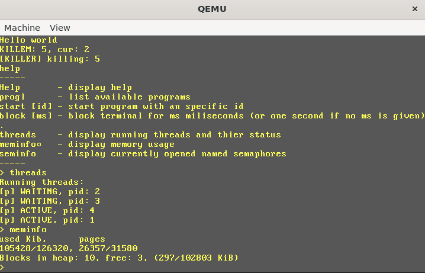

# System
Basic x86 32bit operating system, featuring:
* Text input/output
* Virtual memory 
* Multithreading (no multiprocessing, everything is executed on one cpu)
* and loading programs in elf format (example program in prog directory. Have then be pasted in code since mass storage is not supported)

## Building
Building requires i686-elf cross compiler, binaries for debian based linux can be obtained from [releases](http://google.com), or created using instructions in [osdev wiki](https://wiki.osdev.org/GCC_Cross-Compiler). Additionally nasm is used as an assembler.

After obtaining compiler modify path to it in make file and execute `make`, or `make start` to build and start the system (requires grub-mkrescue and qemu).
